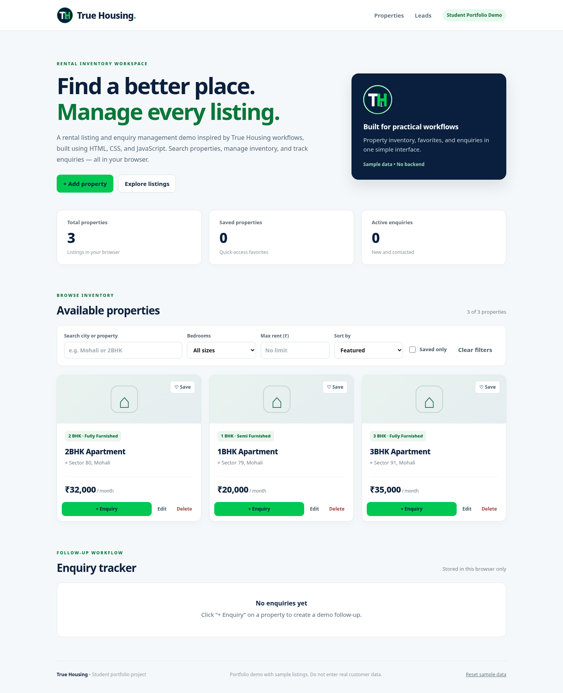

# True Housing — Property Search & Management System

A responsive **rental inventory and enquiry management demo** built with **HTML, CSS and vanilla JavaScript**. It models practical property-brokerage workflows: finding listings, managing property records, saving favorites and tracking enquiry follow-ups.

**[Live demo](https://chaitanya0001-1.github.io/property-search-app/) · [Source code](https://github.com/chaitanya0001-1/property-search-app) · [Test report](TEST_REPORT.md) · [Interview guide](INTERVIEW_GUIDE.md)**

> **Portfolio project, not a production brokerage platform.** All listings and enquiries are fictional sample data. The app runs entirely in the browser; there is no backend, authentication or shared database. Please do not enter real customer information.

## Screenshots



[View mobile screenshot](screenshots/mobile.png)

## What you can do

- **Find properties:** Search by title or location, filter by bedroom count, maximum monthly rent and favorites, and sort by price.
- **Manage inventory:** Add, edit and delete demo property listings with input validation.
- **Track enquiries:** Create demo enquiries, update their status and remove records.
- **Save favorites:** Mark listings for quick access.
- **Keep local changes:** Persist properties, favorites and enquiries in browser `localStorage`.
- **Use across screen sizes:** Responsive dashboard with summary counts and mobile-friendly layouts.

## Tech stack

| Area | Implementation |
| --- | --- |
| Interface | Semantic HTML5 and responsive CSS3 |
| Application logic | Vanilla JavaScript (no UI framework) |
| Persistence | Browser `localStorage` |
| DOM rendering | `document.createElement` and `textContent` |
| Automated tests | Node.js built-in test runner (`node:test`) |
| Hosting | GitHub Pages |

No production server, database, external API or JavaScript package dependency is required to run the app.

## Architecture

```text
index.html               Page structure, controls and dialogs
style.css                Responsive layout and visual design
logic.js                 Pure filtering, sorting, formatting and validation functions
script.js                UI state, event handlers, DOM updates and localStorage
assets/                  Branding assets
screenshots/             Desktop and mobile previews
tests/logic.test.js      20 automated logic tests
TEST_REPORT.md           Audit results and testing limitations
INTERVIEW_GUIDE.md       Architecture walkthrough and interview preparation
```

The browser loads `logic.js` before `script.js`. On startup, the app reads the stored state or loads three sample listings. UI interactions update the state, save it in `localStorage`, and rerender the relevant view. Keeping filter, sort and validation logic separate from the DOM makes those functions easier to test.

## Run locally

1. Clone the repository:

   ```bash
   git clone https://github.com/chaitanya0001-1/property-search-app.git
   cd property-search-app
   ```

2. Open `index.html` in Chrome or Edge, or serve the folder using a local static server.
3. Try searching, applying filters, saving a favorite, and creating a fictional listing or enquiry.
4. Refresh in the same browser and origin to check local persistence. Use **Reset sample data** to restore the default records.

`localStorage` is specific to the browser and origin; the live GitHub Pages site and a local copy will not share saved data.

## Run automated tests

With Node.js installed, execute:

```bash
node --test tests/logic.test.js
```

The suite includes **20 unit tests** for filtering, search, sorting, favorites, input validation and currency formatting. The audited project package passed all 20; the [test report](TEST_REPORT.md) also documents 22 isolated browser interaction checks and their limitations.

## Engineering decisions and limitations

- **Separation of concerns:** `logic.js` provides pure functions; `script.js` handles browser state and rendering.
- **Basic injection safety:** User-entered strings are rendered as text, not interpreted as HTML.
- **Client-side persistence:** Fast and straightforward for a demo, but unsuitable for shared, multi-user operations.
- **Not production-ready:** No server-side validation, authorization, database, user accounts or real-time synchronization.

Potential future extension: a Java/Spring Boot API, PostgreSQL, authentication, and integration tests. These are **planned improvements, not implemented features**.

---

Built as a software engineering portfolio project inspired by True Housing rental workflows. [Explore the live demo](https://chaitanya0001-1.github.io/property-search-app/).
